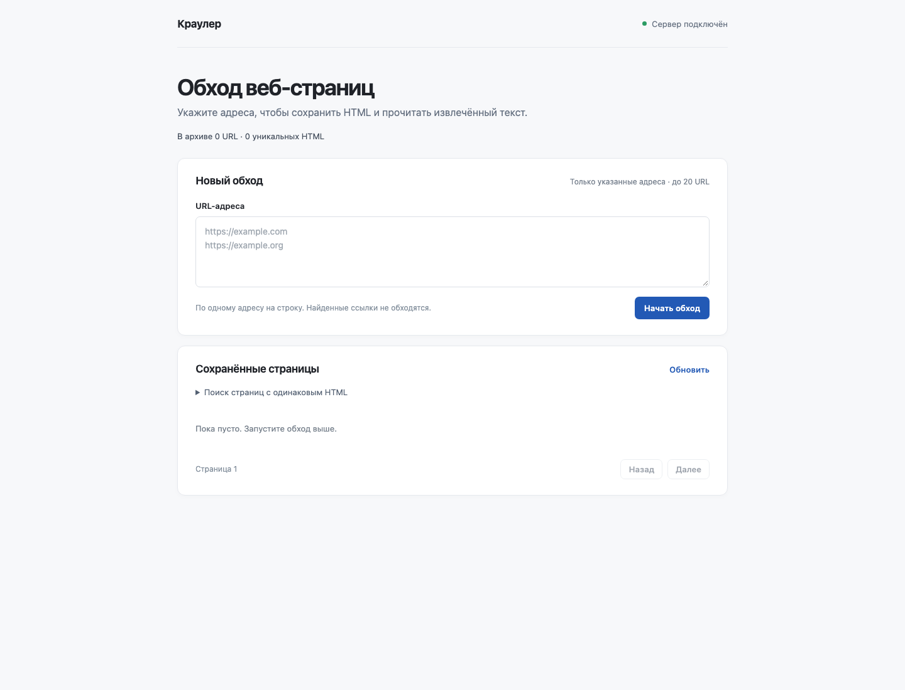
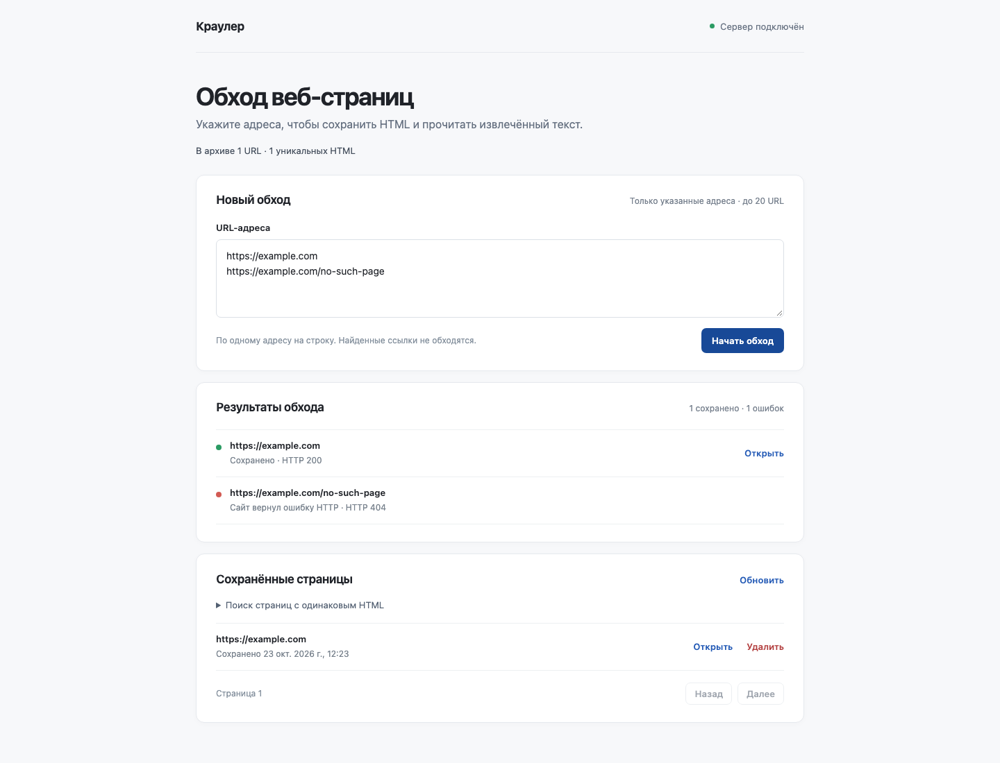
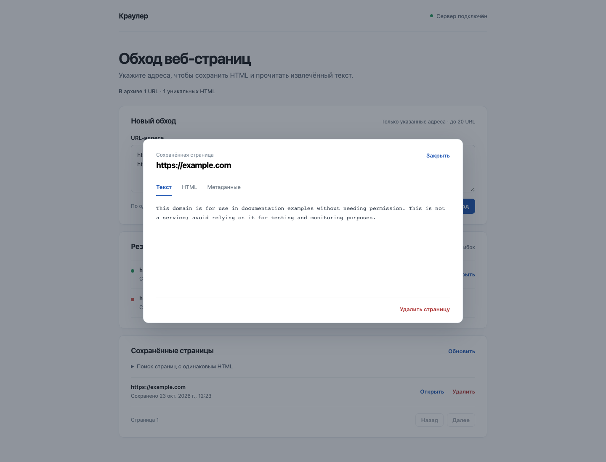

# Краулер заданных URL

Приложение принимает список веб-адресов, скачивает разрешённые HTML-страницы и сохраняет их. В React-клиенте можно запустить обход, увидеть результат каждого адреса, открыть исходный HTML, извлечённый текст и метаданные, отфильтровать каталог по SHA-256 или удалить запись.

Основа идеи — [схема в Excalidraw](schemas/internet_scraper.excalidraw) и её [SVG-версия](schemas/internet_crawler.svg): приём URL, проверка robots.txt, скачивание, сохранение HTML и метаданных, разбор страницы. Для этого задания сервер обходит **только переданные адреса**. Ссылки, найденные в HTML, не становятся новыми задачами.

Сервер: Python 3.12, Litestar, `curl_cffi` (libcurl) для HTTP-запросов, Protego, selectolax с парсером Lexbor на C, SQLite. Клиент: React 19, TypeScript, TanStack Start, TanStack Query, Zod. Сохранены серверные адаптеры исходного проекта для DynamoDB и S3.

## Возможности клиента

- Обход 1–20 заданных URL: проверка адресов до отправки, удаление повторов, индикатор загрузки и результаты по каждому URL, включая ошибки HTTP и robots.txt.
- Каталог с числом сохранённых страниц и уникальных HTML, фильтром по полному SHA-256 и постраничной навигацией.
- Просмотр извлечённого текста, исходного HTML и метаданных страницы; удаление URL из каталога.
- Сообщения об ошибках API и адаптивный интерфейс для компьютера и телефона.

Интерфейс разделён на компоненты формы обхода, результатов, каталога, просмотра страницы и сообщений о состоянии; страница связывает их с запросами к серверу.

TanStack Start обращается к Python API через серверные функции. Адрес API задаётся переменной `CRAWLER_API_URL`; по умолчанию это `http://127.0.0.1:8000`. Поэтому браузеру не нужен отдельный CORS-доступ к Python-серверу.

## Функциональные требования

| № | Требование | Как проверить |
|---|---|---|
| F1 | Принимать список из 1–20 HTTP(S)-адресов. | `POST /crawl` принимает JSON `{"urls": [...]}`; одинаковые адреса в одном списке обрабатываются один раз. |
| F2 | Скачивать HTML по каждому адресу. | Сервер выполняет GET и следует максимум пяти HTTP-перенаправлениям. |
| F3 | Соблюдать robots.txt. | Перед скачиванием проверяются правила для `StudyCrawler/1.0`; запрещённые страницы не запрашиваются. |
| F4 | Показывать результат обработки каждого адреса. | Ответ `/crawl` содержит массив `items` и числа `saved`, `failed`; ошибка одного адреса не прерывает обработку остальных. |
| F5 | Сохранять HTML и метаданные успешной загрузки. | Для URL доступны HTML, SHA-256 содержимого, ссылка на хранилище и время загрузки. Повторная загрузка обновляет запись URL. |
| F6 | Отдавать сохранённый HTML. | `GET /html?url=…` возвращает HTML либо `404`. |
| F7 | Извлекать текст страницы. | `GET /text?url=…` разбирает сохранённый HTML с помощью selectolax/Lexbor и возвращает текст без `script`, `style` и содержимого `head`. |
| F8 | Не хранить одинаковый HTML дважды. | Страницы с одинаковым содержимым получают один SHA-256 и один ключ объекта. |
| F9 | Искать сохранённые страницы. | `GET /url-data?url=…` находит запись; `GET /urls` выдаёт страницы каталога и фильтрует их по хешу. |
| F10 | Удалять URL из каталога. | `DELETE /url-data?url=…` возвращает `204`; дальнейшее чтение записи возвращает `404`. |

## Нефункциональные требования

| № | Требование | Критерий проверки |
|---|---|---|
| N1 | Сохранять результаты между запусками. | После перезапуска с тем же SQLite-файлом доступны прежние HTML и метаданные. |
| N2 | Проверять входные данные. | Некорректный URL, хеш, размер списка и неизвестные поля дают `400` до записи или скачивания. |
| N3 | Ограничивать объём данных. | HTML — не более 1 МиБ в UTF-8; robots.txt — 512 КиБ; тело API-запроса — 8 МиБ; страница каталога — максимум 100 записей. |
| N4 | Быстро выдавать страницу локального каталога. | p95 для `GET /urls?limit=20` на 1000 записях — менее 200 мс через ASGI TestClient, 50 запросов после прогрева. |
| N5 | Ограничивать нагрузку на сайты. | Не более четырёх адресов обрабатываются одновременно; к одному сайту запросы идут по одному с паузой не менее секунды и учётом `Crawl-delay` / `Request-rate`. |
| N6 | Ограничивать время скачивания. | Один HTTP-запрос — до 10 с; обработка одного адреса после получения свободного слота — до 30 с. Ошибка возвращается в результате этого адреса. |
| N7 | Не обращаться к локальным сетевым адресам. | IP-адрес в URL, все DNS-ответы и каждый redirect проверяются; HTTP-клиенту передаются только проверенные IP. Loopback, private и link-local адреса отклоняются. |
| N8 | Разбирать HTML без запуска кода страницы. | Текст извлекается нативным парсером Lexbor; JavaScript не исполняется, ресурсы и ссылки из HTML не загружаются. |
| N9 | Воспроизводимо запускаться на новой машине. | Python 3.12, `uv sync --frozen`, SQLite без внешних сервисов; путь БД и настройки AWS задаются через окружение. |
| N10 | Проходить автоматические проверки. | Тесты, Ruff, Black, isort и mypy проходят в GitHub Actions; покрытие серверного кода — не ниже 90%. |

## Запуск клиента и сервера

Понадобятся [uv](https://docs.astral.sh/uv/getting-started/installation/) и Node.js 24+ с npm. Из корня репозитория запустите сервер в первом терминале:

```bash
git clone https://github.com/JumbikTank/web-crawler-api.git
cd web-crawler-api
uv sync --frozen
uv run --frozen uvicorn crawler.app:app --host 127.0.0.1 --port 8000
```

Во втором терминале из корня репозитория запустите клиент:

```bash
cd client
npm ci
npm run dev
```

Откройте <http://127.0.0.1:3000>. Документация Python API: <http://127.0.0.1:8000/schema/swagger>. По умолчанию база создаётся в `data/crawler.sqlite3`. Если сервер работает по другому адресу, задайте `CRAWLER_API_URL` перед запуском клиента. Для проверки production-сборки клиента: `npm run build && npm run start`.

Без клиента API можно вызвать напрямую:

```bash
curl http://127.0.0.1:8000/crawl \
  -H 'Content-Type: application/json' \
  -d '{"urls":["https://example.com","https://example.org"]}'

curl -G http://127.0.0.1:8000/text --data-urlencode 'url=https://example.com'
curl -G http://127.0.0.1:8000/html --data-urlencode 'url=https://example.com'
```

`POST /crawl` отвечает после обработки списка. HTTP `200` означает, что пакет обработан; успех или ошибку конкретного URL показывает поле `status` каждого элемента в `items`. Ошибки скачивания не сохраняются в базе. Текст создаётся из сохранённого HTML при вызове `/text`, без нового запроса к сайту.

Сервер запрашивает переданные страницы, нужные для них `robots.txt` и адреса HTTP-перенаправлений. Он не выполняет JavaScript и не переходит по ссылкам внутри страниц. Для локальной демонстрации используется один процесс Uvicorn; выполняющийся запрос `/crawl` после перезапуска не продолжается, уже сохранённые страницы остаются.

## Проверки

```bash
uv sync --frozen --extra dev
uv run --frozen pytest
uv run --frozen ruff check crawler tests
uv run --frozen black --check crawler tests
uv run --frozen isort --check-only crawler tests
uv run --frozen mypy crawler tests

cd client
npm ci
npm run build
npm run typecheck
npm run format:check
npx playwright install chromium
npm run test:e2e
```

Python-тесты используют временную SQLite и контролируемый HTTP-сайт. Playwright-тест самостоятельно запускает отдельные экземпляры Python API и клиента на портах `8100` и `3100`, обходит реальный `https://example.com`, проверяет сохранение через API, показывает ошибку для отсутствующей страницы, просматривает данные и удаляет запись. Для него нужен доступ к сети; настоящий AWS не нужен. GitHub Actions проверяет Python-тесты и сборку/типы клиента.

## Скриншоты и видео







[Видео полного сценария в браузере (MP4)](docs/demo.mp4) записано во время прохода Playwright-теста: валидация URL → загрузка успешной и ошибочной страницы → текст/HTML/метаданные → удаление. Отдельный E2E-тест проверяет фильтр SHA-256. Видео хранится в этом публичном репозитории.

## Хранение

Локально HTML и метаданные находятся в SQLite. Можно выбрать `STORAGE_BACKEND=aws` и указать `DYNAMODB_TABLE`, `S3_BUCKET`, `AWS_DEFAULT_REGION` и стандартные учётные данные boto3. Для DynamoDB нужна таблица с ключом `url` типа String, для S3 — созданный бакет. AWS-адаптеры проверяются в тестах с моками; запуск с настоящим AWS в этой работе не проверялся.

Сохранены вспомогательные методы исходного проекта: `POST /html` для загрузки готового HTML, `POST /urls` и `POST /urls/batch` для записи адресов без скачивания, `GET /stats` для статистики каталога. Поле `s3_link` используется в обоих режимах хранения: для SQLite оно содержит `sqlite://html/<hash>`.

При сбое между сохранением HTML и записью метаданных возможен объект без ссылки. Удаление URL не удаляет объект HTML, на который могут ссылаться другие адреса.
